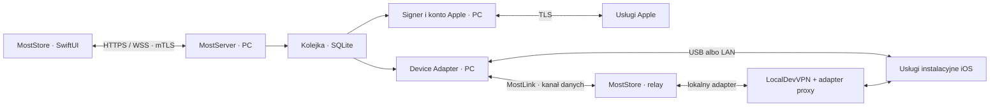

# Architektura Most

Dokument opisuje docelowy projekt. Żaden adapter urządzenia nie został jeszcze zaimplementowany w tym repozytorium.

## 1. Podział odpowiedzialności



Kanał do Apple jest zewnętrzną zależnością podpisywania. „Bez chmury” oznacza brak wymaganego backendu operatora Most, a nie działanie podpisywania bez usług Apple.

## 2. Proponowany stos

| Obszar | Wybór początkowy | Uzasadnienie / warunek |
| --- | --- | --- |
| Rdzeń PC | Python 3.12, asyncio | Integracja z bibliotekami urządzeń, mały prototyp |
| API | FastAPI, Pydantic, Uvicorn | Typowany kontrakt i zdarzenia; TLS/mTLS konfigurowany przed udostępnieniem sieci |
| Interfejs PC | PySide6, zasobnik systemowy | Natywny proces Windows; audyt licencji Qt i sposobu pakowania |
| Urządzenie PC | Adapter nad pymobiledevice3 | Kandydat GPL-3.0, przypięta wersja i test Windows przed przyjęciem |
| Podpisywanie | Osobny worker i adapter do zweryfikowanego silnika, np. AltSign | Build Windows, profilowanie i autoryzacja Apple to bramka etapu 0, nie gotowa funkcja FastAPI |
| Dane PC | SQLite + magazyn plików według SHA-256 | Mały zakres, jawne transakcje i odtwarzanie zadań |
| Sekrety PC | DPAPI / Windows Credential Manager | Dostęp ograniczony do użytkownika uruchamiającego serwer |
| Klient | SwiftUI, URLSession, Network.framework, Keychain | Natywny iOS, certyfikat klienta i przypięta tożsamość PC |
| MostTunnel | Adapter do istniejącego LocalDevVPN i zweryfikowanego proxy | Osobny prototyp Swift/Rust FFI; nie zakładamy zgodności bibliotek tylko na podstawie README |
| Pakowanie | PyInstaller + podpisany instalator Windows | Dopiero po audycie bibliotek, sterowników i możliwości redystrybucji |

To propozycje do prototypu, nie obietnica gotowego stosu produkcyjnego. Dokładne wersje i sumy artefaktów zostaną przypięte po bramce 0. Nie dopisujemy zależności aplikacji, zanim nie ma implementacji.

Proponowany późniejszy podział kodu:

```text
apps/server/              interfejs PC, API, kolejka
apps/ios/                 MostStore, UI i transport
packages/protocol/        schematy, fixtures zgodności
packages/device-adapter/  USB, LAN i Remote
packages/signing-adapter/ worker podpisujący
tests/integration/        testy z fizycznym iPhonem
site/                    obecna strona GitHub Pages
docs/                    obecna dokumentacja
```

## 3. Trzy różne rodzaje połączenia

### USB i LAN

Apple Mobile Device Service na Windows udostępnia połączenie z urządzeniem. USB służy do pierwszego parowania. LAN wymaga wspieranego wykrywania, włączonych połączeń Wi-Fi i istniejącego rekordu parowania. Bonjour ułatwia wykrywanie w tej samej sieci; nie jest uwierzytelnianiem ani protokołem routowanym przez internet.

PC otwiera sesję lockdown, rozpoczyna dozwolone usługi, wysyła IPA i prowadzi instalację. Dokładny zestaw usług, np. AFC i installation_proxy, jest częścią adaptera i testów dla konkretnego iOS. Nie otwieramy publicznie portów usbmuxd, lockdown ani debugserver.

### MostLink — połączenie zdalne z PC

MostStore inicjuje połączenie wychodzące `wss://` do własnego PC. Serwer wymaga mTLS po pierwszym parowaniu, a telefon przypina tożsamość serwera. Kanał niesie kontrolę zadań oraz osobne, ograniczone strumienie adaptera urządzenia.

Połączenie działa przez zwykły internet, niezależnie od lokalnego tunelu iOS. Ruch do PC musi pozostać poza trasami lokalnego tunelu. Testujemy to rzeczywistym transferem, a nie tylko odczytem stanu VPN.

| Sytuacja PC | Obsługiwana ścieżka |
| --- | --- |
| Ta sama sieć | Bezpośredni LAN i lokalne wykrywanie |
| Publiczny adres / własny DNS | Ręcznie włączony TLS listener i świadome przekierowanie portu; bez UPnP |
| CGNAT / brak możliwości połączenia przychodzącego | Samodzielnie zapewniona osiągalna trasa lub późniejszy relay użytkownika; poza domyślną konfiguracją |
| Overlay VPN do domu | Opcja dopiero po teście zgodności z lokalnym VPN iOS; nie obiecujemy dwóch jednoczesnych tuneli |

W MVP listener sterujący jest lokalny. LAN jest włączany w kreatorze z wąską regułą zapory i obowiązkowym uwierzytelnianiem. Publiczne udostępnienie jest oddzielną opcją Beta Remote. Nie ma centralnego katalogu urządzeń, publicznej usługi logowania Most ani obowiązkowego relaya.

### MostTunnel — lokalny most na iPhonie

LocalDevVPN tworzy lokalny wirtualny interfejs. Odpowiedni proxy/adapter, znany z podejścia SideStore, może umożliwić aplikacji kontakt z usługami własnego iPhone’a. Samo zainstalowanie profilu VPN nie wystarczy.

W projekcie Most relay w aplikacji przekazuje bajty wyłącznie do zatwierdzonych lokalnych endpointów usług urządzenia. MostServer nadal posiada klucze podpisujące, autoryzuje zadanie i prowadzi protokół instalacji. Nie powstaje niezależny signer na telefonie.

**Ta ścieżka jest hipotezą techniczną do sprawdzenia.** Istnienie działającego SideStore nie dowodzi, że jego adapter będzie działać jako przezroczysty zdalny transport Most ani że obsłuży wszystkie iOS.

## 4. VPN, entitlement i tunel deweloperski Apple

| Pojęcie | Co robi | Czego nie zapewnia |
| --- | --- | --- |
| LocalDevVPN | Lokalny interfejs i trasy na iOS, bez zewnętrznego serwera VPN | Łączności z domowym PC ani podpisu IPA |
| MostLink | Kanał PC–telefon przez LAN lub internet | Samodzielnego dostępu do installation_proxy |
| CoreDevice / RSD | Dostęp do części usług deweloperskich Apple, szczególnie od iOS 17 | Zamiennika LocalDevVPN ani automatycznego wymogu dla każdej zwykłej instalacji |
| Developer Mode | Wymagane przez iOS dopuszczenie określonych aplikacji deweloperskich | Uprawnienia Network Extension ani zniesienia limitów profilu |

Własny packet tunnel provider wymaga dopuszczonych capabilities, poprawnego provisioning profile i właściwej dystrybucji. Nie zakładamy dostępności tego rozszerzenia dla bezpłatnego Personal Team. Pierwsza wersja korzysta z oddzielnego LocalDevVPN, jeśli jego dystrybucja jest dostępna na urządzeniu i w regionie użytkownika.

MostStore może pokazywać instrukcję uruchomienia zewnętrznego VPN. Nie zakładamy istnienia publicznego API do włączania jego konfiguracji lub odczytu jej stanu; przy braku takiego API wykonujemy próbę funkcjonalną lokalnego kanału. Własny provider później może udostępniać dokładniejszy stan przez kontrolowane IPC/App Group.

JIT, debugserver i montowanie obrazów deweloperskich to oddzielne możliwości. Nie dodajemy ich do instalatora tylko dlatego, że biblioteka je obsługuje. Odmienności iOS 17.0–17.3.1 i 17.4+ w tunelach RSD nie oznaczają automatycznie takich samych różnic w zwykłej instalacji IPA.

## 5. Bootstrap i zaufanie

1. Parowanie Apple przez USB; rekord pozostaje na PC, z uprawnieniami pliku ograniczonymi do użytkownika.
2. Pierwszy MostStore jest podpisywany i instalowany z PC. Nie ma problemu „klient musi być zainstalowany, żeby go zainstalować”.
3. PC tworzy jednorazowy token QR o losowości co najmniej 256 bitów, ważny 120 sekund. QR zawiera endpoint i fingerprint klucza serwera; nie zawiera hasła Apple ani rekordu lockdown.
4. MostStore generuje klucz klienta w Keychain, używając Secure Enclave, jeżeli konfiguracja klucza i TLS na to pozwala. Sprawdza pin serwera i wysyła żądanie parowania z własnym kluczem publicznym.
5. Użytkownik potwierdza nowe urządzenie na PC. Serwer atomowo zużywa token i wydaje tożsamość mTLS przypisaną do konkretnego urządzenia Apple.
6. Odwołanie zaufania zamyka sesje i uniemożliwia nowe zadania. Odnowienie/rotacja certyfikatów zachowuje kontrolowany łańcuch zaufania; zmiana tożsamości PC wymaga ponownego potwierdzenia.

Parowanie aplikacji nie daje zaufania wszystkim iPhone’om podłączonym do tego PC. Klient ma dostęp wyłącznie do przypisanego `device_id`. Rekord parowania Apple nie trafia do telefonu, jeżeli adapter potrafi prowadzić uwierzytelnianie po stronie PC; każda konieczność zmiany tego założenia wymaga osobnej decyzji przed wdrożeniem.

## 6. Konto Apple i podpisywanie

- Autoryzacja, 2FA, sesja Apple, zespoły i profile są zamknięte w adapterze PC. Nie implementujemy własnej kryptografii protokołów logowania na podstawie zgadywania.
- Sprawdzamy wymagania anisette i ich zgodną realizację na Windows. Preferowana lokalna, zweryfikowana ścieżka; jeżeli działa wyłącznie nieznana usługa publiczna, bramka etapu 0 pozostaje niezaliczona.
- Najpierw scenariusz z profilem i kluczem użytkownika dla własnej testowej aplikacji, potem pełny scenariusz konta bezpłatnego. Pierwszy nie zastępuje drugiego.
- Hasło nie jest utrwalane domyślnie. Odnawialna sesja i klucz prywatny są zabezpieczone systemowo; ich nieważność oznacza prośbę o zalogowanie na PC.
- Analiza `Info.plist`, binariów i rozszerzeń poprzedza rejestrację App ID. Identyfikatory mają stabilne mapowanie zależne od zespołu i urządzenia.
- Podpisujemy poprawnie cały wymagany graf aplikacji i rozszerzeń. Nie usuwamy potajemnie uprawnień ani rozszerzeń, żeby IPA „przeszła”. Niezgodny pakiet otrzymuje czytelny błąd.
- Sprawdzamy wynik podpisu i zgodność profilu z urządzeniem przed transferem. Nie odwołujemy istniejących certyfikatów innych narzędzi bez zgody użytkownika.

Certyfikaty i profile traktujemy jako stan rzeczywisty z Apple. Typowe limity Personal Team są opisane w [źródłach](ZRODLA.md), ale UI odczytuje dostępne dane, nie obiecuje stałych limitów na zawsze.

## 7. Model danych i odzyskiwanie

| Encja | Najważniejsze pola |
| --- | --- |
| ServerIdentity | publiczny identyfikator, referencja klucza, fingerprint, wersja protokołu |
| Client | klucz/certyfikat, przypisane device ID, status odwołania |
| Device | wewnętrzne ID, zaszyfrowane dane parowania, iOS/build, możliwości transportów |
| AppleSession | zespół, referencje sekretów w magazynie systemowym, termin sesji |
| Artifact | SHA-256, rozmiar, oryginalna IPA, wynik analizy, właściciel |
| InstalledApp | urządzenie, bundle ID i mapowanie, wersja, profil, termin ważności |
| Job | rodzaj, etap, idempotency key, artefakt, urządzenie, wynik, numery zdarzeń |
| Source | jawnie dodany adres HTTPS, polityka zaufania, data ostatniego sprawdzenia |

Magazyn rozdziela niezmienne oryginały i jednorazowe podpisane wyniki. Domyślnie usuwamy podpisane pliki po 24 godzinach; zachowanie oryginału do odnawiania jest widoczną opcją. Logi lokalne mają rotację 7 dni i limit 50 MiB. Nigdy nie usuwamy ostatniego oryginału aplikacji automatycznie bez pokazania wpływu na odnowienie.

Po restarcie zadania w trakcie instalacji przechodzą do `needs_reconciliation`. Sprawdzamy rzeczywisty stan urządzenia, zanim zaproponujemy ponowienie. Nie można obiecać „exactly once” dla obcej usługi instalacyjnej; można zagwarantować idempotentne przyjęcie zadania i uzgodnienie wyniku.

## 8. Bezpieczeństwo i granice procesu

- API nie udostępnia terminala, dowolnych poleceń, nieograniczonego TCP proxy ani publicznego endpointu tunneld. Helper podwyższony tylko do działań faktycznie wymagających uprawnień.
- Podpisujący worker ma minimalny interfejs, limity czasu i osobny proces. Proces obsługujący źródła IPA nie otrzymuje kluczy konta Apple.
- Archiwum: blokada traversal, symlink escape, ZIP bomb, nadmiernej liczby plików i przekroczeń rozmiaru. Rozpakowanie do izolowanego katalogu z ograniczonymi ACL.
- Pobieranie źródeł: HTTPS z weryfikacją, jawne zgody na hosty, kontrola przekierowań i DNS; blokada loopback, link-local, metadanych chmury oraz prywatnych adresów bez osobnej zgody na źródło LAN.
- MostLink: ograniczenia strumieni, przepływu, rozmiaru i czasu bezczynności; endpointy wyłącznie własnego przypisanego iPhone’a. Surowe porty usług Apple nie są dostępne dla obcych klientów.
- Błędy i raporty nie zawierają haseł, cookies, tokenów, kluczy, całych rekordów parowania, pełnych UDID ani zawartości IPA.
- Aktualizacje programu sprawdzają podpis wydawcy; sam SHA-256 pobrany z tego samego niezaufanego miejsca nie potwierdza autora.
- Aplikacje ze źródeł są nieufnym kodem. Podpisanie przez Most oznacza gotowość instalacyjną, nie audyt bezpieczeństwa aplikacji.

## 9. Bramka techniczna Remote

Przed uznaniem Remote za wspierany trzeba udowodnić łącznie:

1. Wyjście telefonu do PC przez TLS działa przy aktywnym LocalDevVPN i przez sieć komórkową.
2. Klient potrafi otworzyć lokalny endpoint własnego urządzenia bez nieprzyznanych entitlementów.
3. Adapter na PC potrafi przeprowadzić uwierzytelnioną sesję urządzenia przez most bajtowy, bez obejścia zaufania Apple.
4. Podpisana na PC IPA zostaje zainstalowana i uruchomiona na fizycznym iPhonie poza LAN.
5. Rozłączenie, blokada ekranu i ubity proces kończą się bez utraty danych i bez fałszywego sukcesu.
6. Osobno zmierzono zachowanie przy aktualizacji samego MostStore; do czasu pozytywnego wyniku pozostaje ścieżka USB/LAN.

Wynik negatywny oznacza udokumentowaną przeszkodę, dalsze R&D oraz działające MVP USB/LAN. Nie zastępujemy testu instalacji zwykłym pingiem lub ekranem „Connected”.
